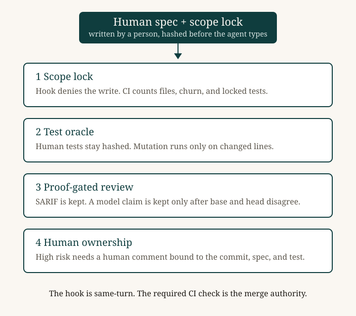
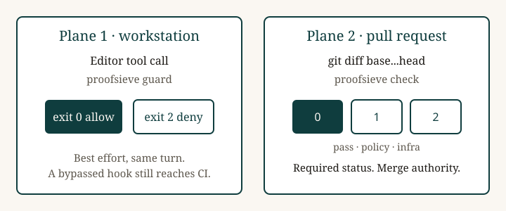

# ProofSieve

**Probabilistic generation. Deterministic verification. Human-owned code.**

ProofSieve is an Apache-2.0 control plane for AI-assisted coding. Coding agents may type. They may not decide scope, grade their own tests, or merge a change nobody can explain.

GitHub About:

> Deterministic control plane for AI-written code. Scope-locks agent edits, mutation-tests the diff, and blocks merge until a human owns the change.

## The failure this stops

Teams are using one model to write code, a second to review it, and a third to write and "pass" the tests. Those errors compound:

| Failure | What it looks like | ProofSieve response |
| --- | --- | --- |
| Lost intent | A bugfix becomes a rewrite of modules the author cannot debug | Spec-linked scope lock, enforced before the write |
| Blast radius | One prompt touches dozens of files, including passing tests | File, line, and test-integrity budgets |
| Review noise | An LLM review posts dozens of unproven nits and trains people to ignore comments | Deterministic checks first. A comment is posted only with a reproduction. Hard cap of 5 |
| Hollow tests | The suite is green because it asserts the same mistake the generator just wrote | Human-owned oracle tests, plus mutation testing on the changed lines |

A second language model is not the judge. Gates 1, 2, and 4 run with no model call. Gate 3 may accept a model finding only after a deterministic reproduction passes.

## Four gates





Local hooks make the agent fix scope while it is still typing. CI is the merge authority, because a hook can be bypassed.

## Install

```
go install github.com/vaquarkhan/ProofSieve/cmd/proofsieve@latest
```

Go 1.23 or newer. The module builds without cgo. Tagged releases also publish static binaries for Linux, macOS, and Windows.

## What the binary does

Version 1.0.0 runs all four gates. Hooks are best-effort. `proofsieve check` in CI is the merge authority.

- `proofsieve init` writes policy, Cursor hooks, and Claude Code hooks.
- `proofsieve lock` writes `.proofsieve/scope.lock.yaml` from a human spec and hashes the oracle tests.
- `proofsieve guard` is the Cursor and Claude Code pre-tool command. Exit 2 denies the write.
- `proofsieve check` fails CI on scope, complexity, locked tests, mutation score, unproven review, and missing attestation. The report includes a behavioral diff: signature changes, sensitive calls, and in-repo callers.
- `proofsieve attest` prints the comment a human pastes on the pull request.

Operator documentation, the tutorial, and the developer guide are published at [https://vaquarkhan.github.io/ProofSieve/](https://vaquarkhan.github.io/ProofSieve/).

## Repository layout

```
cmd/proofsieve/        CLI entrypoint
internal/              gates, hook, mutation, review, attestation
action/                composite GitHub Action
site/                  GitHub Pages
docs/                  architecture, requirements, and roadmap
schemas/               JSON Schemas for scope.lock.yaml and policy.yaml
examples/              sample policy, scope lock, and a caller workflow
```

## Identity

| | |
| --- | --- |
| Name | ProofSieve |
| Command | `proofsieve` |
| Config | `.proofsieve/` |
| License | Apache-2.0 |
| Tagline | Probabilistic generation, deterministic verification |

Earlier names (TenetGate, AssayGate, LintelGate, RigorGate, SieveGate, DiffFence) collide with existing products, scandals, or repositories. ProofSieve does not. RigorCI and BulkheadCI remain unused fallbacks if a trademark review blocks this one.

## Docs

- [Tutorial](https://vaquarkhan.github.io/ProofSieve/tutorial.html)
- [Developer guide](docs/DEVELOPMENT.md)
- [Architecture](docs/ARCHITECTURE.md)
- [Requirements](docs/REQUIREMENTS.md)
- [Roadmap](docs/ROADMAP.md)
- [ADR 0001 — name and enforcement](docs/adr/0001-name-and-enforcement.md)
